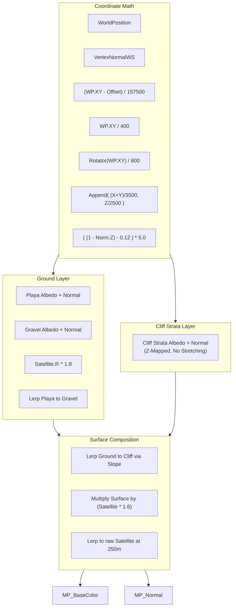

# URC Hanksville Terrain & Material Rebuild Guide

This guide documents the exact setup used to build the Mars Desert Research Station (MDRS / Hanksville) terrain material and environment in Unreal Engine. Follow these steps to reproduce the material graph, texture settings, landscape coordinates, and atmospheric lighting in Unreal Engine 5.6.1 or any other engine version.

---

## 1. Directory Structure

All terrain assets reside under the following project folders:

- **Level Path:** `/Game/MRDTModels/URC_Hanksville/URC_MDRS`
- **Master Material:** `/Game/MRDTModels/URC_Hanksville/URC_Map_Material`
- **Satellite Texture:** `/Game/MRDTModels/URC_Hanksville/urc_satellite_texture1_clean`
- **PBR Textures:** `/Game/MRDTModels/URC_Hanksville/Materials/`

Source images are exported in the local directory:
`/home/targed/Documents/Unreal Projects/URC_Map/Textures/`

---

## 2. Texture Inventory & Import Settings

Import each image from `Textures/` into the content browser and set the compression properties below:

| Texture Name | Target Folder | Type | Compression | sRGB | LOD Group |
| :--- | :--- | :--- | :--- | :--- | :--- |
| `urc_satellite_texture1_clean.png` | `/Game/MRDTModels/URC_Hanksville/` | Color | `TC_Default` | True | `TEXTUREGROUP_World` |
| `MDRS_Playa_Clean_Albedo.png` | `.../URC_Hanksville/Materials/` | Color | `TC_Default` | True | `TEXTUREGROUP_World` |
| `MDRS_Playa_Clean_Normal.png` | `.../URC_Hanksville/Materials/` | Normal | `TC_Normalmap` | False | `TEXTUREGROUP_WorldNormalMap` |
| `MDRS_Gravel_Clean_Albedo.png` | `.../URC_Hanksville/Materials/` | Color | `TC_Default` | True | `TEXTUREGROUP_World` |
| `MDRS_Gravel_Clean_Normal.png` | `.../URC_Hanksville/Materials/` | Normal | `TC_Normalmap` | False | `TEXTUREGROUP_WorldNormalMap` |
| `MDRS_Cliff_Strata_Albedo.png` | `.../URC_Hanksville/Materials/` | Color | `TC_Default` | True | `TEXTUREGROUP_World` |
| `MDRS_Cliff_Normal.png` | `.../URC_Hanksville/Materials/` | Normal | `TC_Normalmap` | False | `TEXTUREGROUP_WorldNormalMap` |

> Set all Texture Sample nodes inside the material graph to **Sampler Source: Shared: Wrap** (`SSM_Wrap_WorldGroupSettings`). This allows the material to use multiple textures without running into the 16-sampler DirectX limit.

---

## 3. Landscape Transform & Math

The landscape actor in `URC_MDRS` is `Landscape_1`. Its world coordinates define how satellite and world-space textures map onto the terrain.

- **Location:** `X = -108250.0`, `Y = -79833.0`, `Z = -1040.0`
- **Scale:** `X = 100.0`, `Y = 100.0`, `Z = 14.742`
- **Bounding Box Min:** `X = -108250.0`, `Y = -79833.0`, `Z = -4813.95`
- **Bounding Box Max:** `X = 49250.0`, `Y = 77667.0`, `Z = 2733.84`
- **Total Span:** `157500.0 cm` (1.575 km) along both X and Y.

### Satellite UV Formula
To align the satellite photograph with the landscape boundaries:

$$\text{UV} = \frac{\text{WorldPosition.XY} - (-108250.0, -79833.0)}{157500.0}$$

---

## 4. Material Architecture Overview



---

## 5. Step-by-Step Material Graph Node Connections

Open `URC_Map_Material` in the Material Editor. Build the six functional blocks below.

### Block 1: Satellite Mapping
1. Create a `MaterialExpressionWorldPosition`.
2. Connect its `XYZ` output to a `MaterialExpressionComponentMask` with `R = True`, `G = True`, `B = False`.
3. Create a `MaterialExpressionConstant2Vector` with values `R = -108250.0`, `G = -79833.0`.
4. Create a `MaterialExpressionSubtract`:
   - `A`: ComponentMask (from step 2)
   - `B`: Constant2Vector (from step 3)
5. Create a `MaterialExpressionScalarParameter`:
   - Parameter Name: `LandscapeDimensions`
   - Default Value: `157500.0`
6. Create a `MaterialExpressionDivide`:
   - `A`: Subtract output
   - `B`: ScalarParameter output
7. Create a `MaterialExpressionTextureSample`:
   - Texture: `urc_satellite_texture1_clean`
   - Connect Divide output to `UVs`

### Block 2: Ground Layer (Playa & Gravel)
1. **Playa UVs:**
   - Create a `MaterialExpressionConstant` with value `400.0`.
   - Create a `MaterialExpressionDivide` (`A`: WorldPosition XY mask from Block 1, `B`: 400.0).
   - Create two `MaterialExpressionTextureSample` nodes (`MDRS_Playa_Clean_Albedo` and `MDRS_Playa_Clean_Normal`). Connect the Divide output to both `UVs` pins.
2. **Gravel UVs:**
   - Create a `MaterialExpressionConstant` with value `0.5` (time/rotation factor).
   - Create a `MaterialExpressionRotator`:
     - `Coordinate`: WorldPosition XY mask
     - `Time`: Constant (0.5)
   - Create a `MaterialExpressionConstant` with value `800.0`.
   - Create a `MaterialExpressionDivide` (`A`: Rotator output, `B`: 800.0).
   - Create two `MaterialExpressionTextureSample` nodes (`MDRS_Gravel_Clean_Albedo` and `MDRS_Gravel_Clean_Normal`). Connect the Divide output to both `UVs` pins.
3. **Playa / Gravel Blend:**
   - Create a `MaterialExpressionPower`:
     - `Base`: Satellite TextureSample `R` pin (from Block 1)
     - `ConstExponent`: `1.8`
   - Create a `MaterialExpressionLinearInterpolate` for Albedo:
     - `A`: Playa Albedo `RGB`
     - `B`: Gravel Albedo `RGB`
     - `Alpha`: Power output
   - Create a `MaterialExpressionLinearInterpolate` for Normal:
     - `A`: Playa Normal `RGB`
     - `B`: Gravel Normal `RGB`
     - `Alpha`: Power output

### Block 3: Slope Mask & Cliff Strata (Anti-Stretching)
1. **Slope Detection:**
   - Create a `MaterialExpressionVertexNormalWS`.
   - Connect to a `MaterialExpressionComponentMask` with `B = True` (Z-normal).
   - Connect to a `MaterialExpressionSaturate`.
   - Connect to a `MaterialExpressionOneMinus` (yields `1.0 - Normal.Z`).
   - Create a `MaterialExpressionSubtract`:
     - `A`: OneMinus output
     - `B`: Constant `0.12` (slopes below ~18° stay flat ground)
   - Create a `MaterialExpressionMultiply`:
     - `A`: Subtract output
     - `B`: Constant `5.0` (steepness transition sharpness)
   - Connect Multiply to a `MaterialExpressionSaturate`. This output is `CliffMask`.
2. **Cliff UVs (Elevation Mapping):**
   - Mask WorldPosition X: `ComponentMask` (`R = True`).
   - Mask WorldPosition Y: `ComponentMask` (`G = True`).
   - Add X and Y together with a `MaterialExpressionAdd`.
   - Divide Add output by Constant `3500.0` (horizontal scale). This is `Cliff_U`.
   - Mask WorldPosition Z: `ComponentMask` (`B = True`).
   - Divide Z output by Constant `2500.0` (strata layer height). This is `Cliff_V`.
   - Create a `MaterialExpressionAppendVector`:
     - `A`: `Cliff_U`
     - `B`: `Cliff_V`
   - Create two `MaterialExpressionTextureSample` nodes (`MDRS_Cliff_Strata_Albedo` and `MDRS_Cliff_Normal`). Connect AppendVector to both `UVs` pins.
3. **Blend Ground into Cliff:**
   - Create a `MaterialExpressionLinearInterpolate` for Surface Albedo:
     - `A`: Ground Albedo Lerp (from Block 2)
     - `B`: Cliff Strata Albedo `RGB`
     - `Alpha`: `CliffMask`
   - Create a `MaterialExpressionLinearInterpolate` for Surface Normal:
     - `A`: Ground Normal Lerp (from Block 2)
     - `B`: Cliff Normal `RGB`
     - `Alpha`: `CliffMask`

### Block 4: Regional Color Modulation
1. Create a `MaterialExpressionConstant` with value `1.6`.
2. Create a `MaterialExpressionMultiply`:
   - `A`: Satellite TextureSample `RGB` (Block 1)
   - `B`: Constant `1.6`
3. Create a `MaterialExpressionMultiply`:
   - `A`: Surface Albedo Lerp (Block 3)
   - `B`: Multiply output from step 2
   - This output is `ForegroundAlbedo`.

### Block 5: Distance Fading
1. Create a `MaterialExpressionCameraPositionWS`.
2. Create a `MaterialExpressionDistance`:
   - `A`: CameraPositionWS
   - `B`: WorldPosition `XYZ`
3. Create a `MaterialExpressionDivide`:
   - `A`: Distance output
   - `B`: Constant `25000.0` (250 meters)
4. Connect Divide to a `MaterialExpressionSaturate`. This output is `DistanceFade`.
5. Create a `MaterialExpressionLinearInterpolate` for Final BaseColor:
   - `A`: `ForegroundAlbedo` (Block 4)
   - `B`: Satellite TextureSample `RGB` (Block 1)
   - `Alpha`: `DistanceFade`
6. Create a `MaterialExpressionConstant3Vector` with value `(0.0, 0.0, 1.0)` (flat normal).
7. Create a `MaterialExpressionLinearInterpolate` for Final Normal:
   - `A`: Surface Normal Lerp (Block 3)
   - `B`: Constant3Vector (0, 0, 1)
   - `Alpha`: `DistanceFade`

### Block 6: Roughness & Specular Tuning
1. Create a `MaterialExpressionConstant` with value `0.85` (ground clay roughness).
2. Create a `MaterialExpressionConstant` with value `0.90` (cliff rock roughness).
3. Create a `MaterialExpressionLinearInterpolate`:
   - `A`: Constant 0.85
   - `B`: Constant 0.90
   - `Alpha`: `CliffMask` (Block 3)
4. Create a `MaterialExpressionConstant` with value `0.22` (calibrated desert soil specular).

### Final Material Output Connections
Connect the following expressions to the material root node:

- `MP_BaseColor` $\leftarrow$ Final BaseColor Lerp (Block 5, step 5)
- `MP_Normal` $\leftarrow$ Final Normal Lerp (Block 5, step 7)
- `MP_Roughness` $\leftarrow$ Roughness Lerp (Block 6, step 3)
- `MP_Specular` $\leftarrow$ Specular Constant 0.22 (Block 6, step 4)

Save and recompile the material.

---

## 6. Level Atmosphere & Lighting Setup

Open level `URC_MDRS` in the editor.

### Ultra Dynamic Sky (`Ultra_Dynamic_Sky_C_0`)
Select `Ultra_Dynamic_Sky_C_0` in the outliner and set:
- **Dust Amount:** `2.5`
- **Dust Color:** Default warm brown (`R = 0.26`, `G = 0.22`, `B = 0.18`)

### Ultra Dynamic Weather (`Ultra_Dynamic_Weather_C_0`)
Select `Ultra_Dynamic_Weather_C_0` in the outliner and set:
- **dust - Manual Override:** `True`
- **dust:** `2.5`
- **material Dust Coverage - Manual Override:** `True`
- **material Dust Coverage:** `0.3`

---

## 7. Automated Python Reconstruction (UE 5.6.1)

To rebuild everything automatically in Unreal Engine 5.6.1 without wiring nodes by hand:

1. Copy the script `/home/targed/Documents/Unreal Projects/URC_Map/build_urc_material.py` into your UE 5.6.1 environment.
2. Open Unreal Editor 5.6.1 with `RoveSoSimulator.uproject`.
3. Open **Window -> Output Log**.
4. In the bottom command prompt, switch the dropdown from `Cmd` to `Python`.
5. Run:
   ```python
   py "/home/targed/Documents/Unreal Projects/URC_Map/build_urc_material.py"
   ```
6. The script imports all textures, builds the graph, compiles the shader, and applies the sky atmospheric settings in about 15 seconds.

---

## 8. Verification Checklist

After applying the setup, inspect the viewport from three viewpoints:

1. **Rover Eye Level (Z = 50cm above ground):** Mudcracks and gravel should appear sharp and 3-dimensional with no repeating diagonal line artifacts.
2. **Horizon / Glancing Angle:** The ground should look powdery and dry under sunlight, with no plastic shine or mirror reflections.
3. **Distant Bluffs and Mountains:** Steep hillsides should show horizontal geological strata banding rather than vertical smear streaks.
